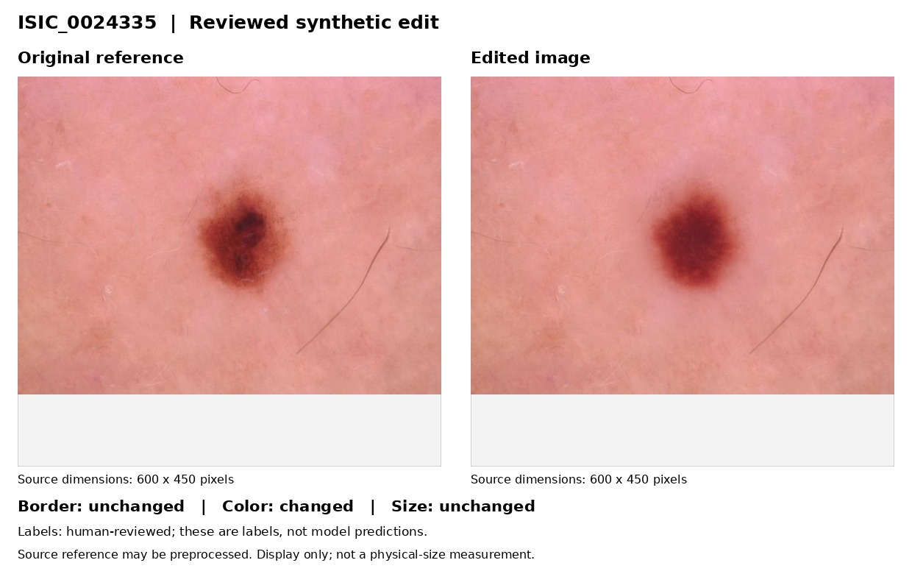
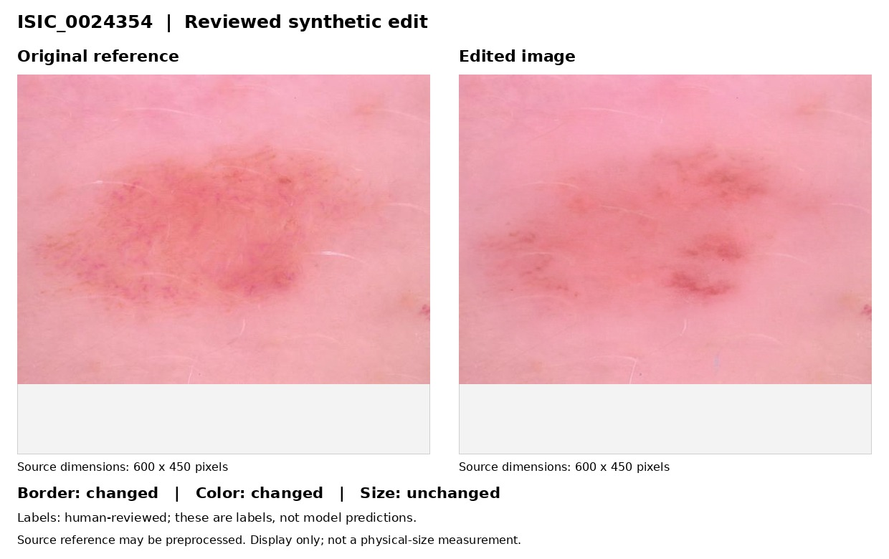
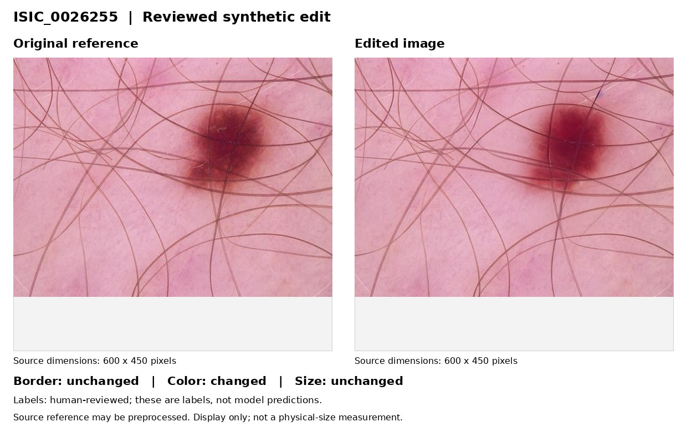
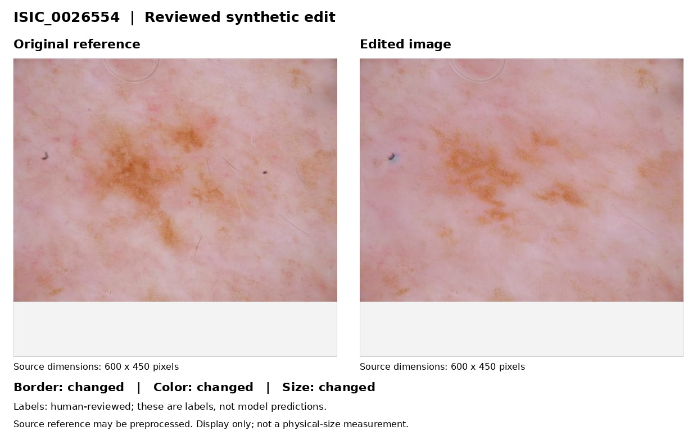
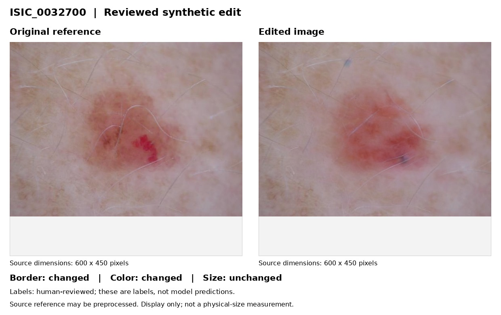

# Synthetic Dermoscopic Calibration Data

Data accompanying **Interpretable Dermoscopic Follow-Up with ABCD Measurements and Synthetic Calibration**.

This release provides **943 reviewed edited images**, **825 no-change
transformed images**, their pair labels, and **1886 image-level asymmetry
annotation records**. Each derived image is linked to its source ISIC image.
The data support feature-threshold calibration, not clinical diagnosis.

## Contents

```text
edited/         943 reviewed synthetic edits
nochange/       825 transformed images
metadata.csv    Source references, derived paths, and B/C/D pair labels
asymmetry.csv   Image-level A labels; originals are referenced, not included
examples/       Some derived-image previews
README.md
```

## Important notes

- **Original ISIC source/reference images are not stored in this repository.**
  The `original_file_name` column (for example, `ISIC_0024315.jpg`) is an archive
  reference, not a local path. Obtain originals separately from the
  [ISIC Archive](https://www.isic-archive.com/).
- The `nochange/` folder contains **transformed versions of real ISIC images**,
  not newly generated lesions. Edited images can also retain source-image content.
- Previews show only derived images. No private real evaluation images are included.
- Reference images used during calibration may have been cropped or resized.
  The source ID alone does not reproduce that preprocessing.
- Synthetic edits illustrate appearance changes, not real disease progression.


## Labels

| Column in `metadata.csv` | Meaning |
|---|---|
| `pair_id`, `source_isic_id` | Pair identifier and ISIC source identifier |
| `original_file_name` | Original ISIC archive reference; file not included |
| `derived_image` | Relative path to the included edit or transformation |
| `subset` | `edited` or `nochange` |
| `border_changed`, `color_changed`, `size_changed` | `1` = changed; `0` = unchanged |
| `transform_group` | Geometric, photometric, or mixed; blank for edits |

Edited-pair labels were reviewed by human annotators. No-change B/C/D labels
are assigned by construction. Size labels describe apparent-size change,
not a clinical growth threshold. Exact transform parameters are not included.

In `asymmetry.csv`, `asymmetric=1` means asymmetric and `0` means symmetric.
When `included_in_repository=1`, `image` is a relative path to an included edit.
When it is `0`, `image` is an external ISIC filename; no image file is supplied.

## Examples

Only the edited/transformed image is shown. Previews are resized for viewing,
not for physical-size measurements.

**ISIC_0024315 - reviewed edit**



**ISIC_0024319 - reviewed edit**



**ISIC_0024319 - geometric no-change transform**



**ISIC_0024323 - photometric no-change transform**



**ISIC_0024315 - mixed no-change transform**



## Citations

This research is supported by Belle.ai. If you use these images in your research, please cite our paper.
